<p align="center">
  <picture>
    <source media="(prefers-color-scheme: dark)" srcset="docs/assets/banner-dark.png">
    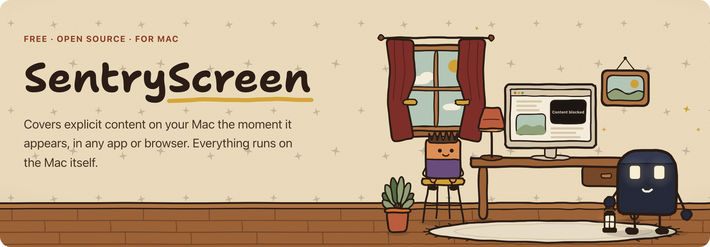
  </picture>
</p>

<p align="center">
  <b>Explicit content on your Mac, covered the moment it appears.</b><br>
  Free and open source. Everything runs on the Mac itself.
</p>

<p align="center">
  <a href="LICENSE"></a>
  
  
  
</p>

<p align="center">
  <a href="https://github.com/SaintsGlobal/sentryscreen/releases"><b>Download</b></a> ·
  <a href="#build-from-source">Build from source</a> ·
  <a href="https://www.sentry-screen.com">Website</a> ·
  <a href="model/README.md">Model card</a> ·
  <a href="#help-make-it-better">Help make it better</a>
</p>

---

SentryScreen is a small, free app for a family Mac. It watches what is on the
screen, detects nudity with an on-device model, and drops a solid black cover over
it. It works in any app (browsers, chat, Finder, video players) because it looks at
pixels, not at websites or settings.

It is built for a family Mac: a parent sets it up in an administrator account, and
a child uses a Standard account.

## How it works

<table>
  <tr>
    <td width="50%" align="center">
      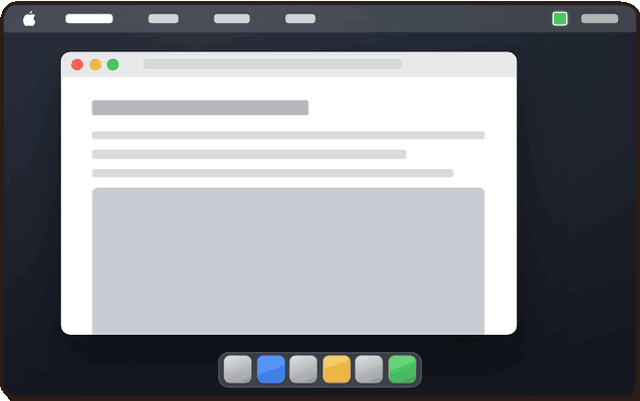<br>
      <b>In a browser.</b> The cover lands on the picture and stays on it as the page scrolls.
    </td>
    <td width="50%" align="center">
      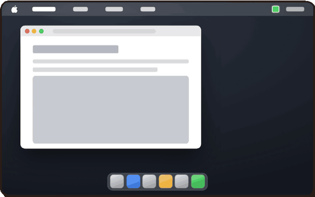<br>
      <b>It follows the window.</b> Drag the window and the cover rides along.
    </td>
  </tr>
  <tr>
    <td width="50%" align="center">
      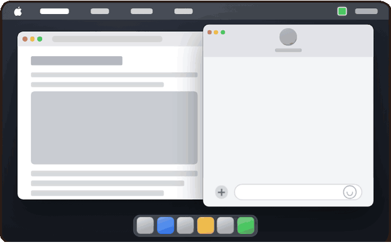<br>
      <b>In a chat, or any other app.</b> No list of blocked websites: it reads the pixels.
    </td>
    <td width="50%" align="center">
      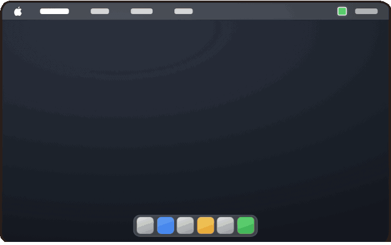<br>
      <b>The whole window, if it has to.</b> One cover over the window until the content is gone.
    </td>
  </tr>
</table>

<sub>Animations are synthetic drawings from the <a href="https://www.sentry-screen.com">website</a>, shown at double speed. The real cover is the same plain black rectangle.</sub>

Under the hood: a frame from the screen goes to a Core ML detector in memory, a
tracker keeps covers steady as things move, and a click-through overlay draws the
cover. [docs/spec.md](docs/spec.md) has the full pipeline (capture → detect → track → cover).

## Features

- 🪟 **Curtain mode (default).** When a window shows explicit content, one solid
  cover hides that whole window and follows it as it moves. It lifts after the
  window has shown clean content for a few seconds.
- 🔲 **Region and media modes.** Region mode covers each detected area only; media
  mode also covers the whole video player around it.
- 🔒 **Parent controls** in the menu bar (administrator sessions only): pause,
  sensitivity, recent activity and a parent PIN. A Standard account sees a
  read-only status.
- 🔁 **Always on.** A LaunchAgent runs it in every login session and a
  watchdog restarts it if it is stopped. Losing Screen Recording permission is
  shown to the parent, not hidden.
- 🏠 **On-device.** No account, no subscription, no telemetry. See [Privacy](#privacy).

## Screenshots

<table>
  <tr>
    <td align="center">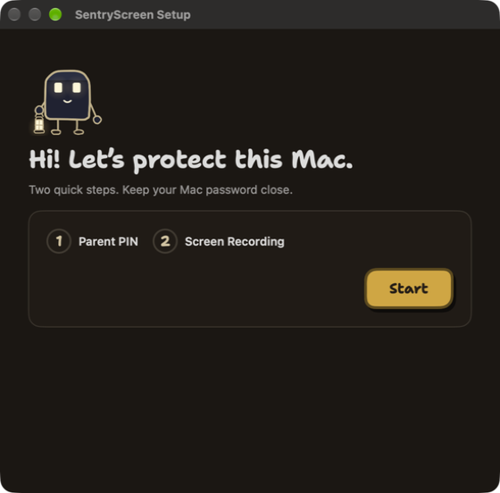<br><sub>Two-step setup</sub></td>
    <td align="center">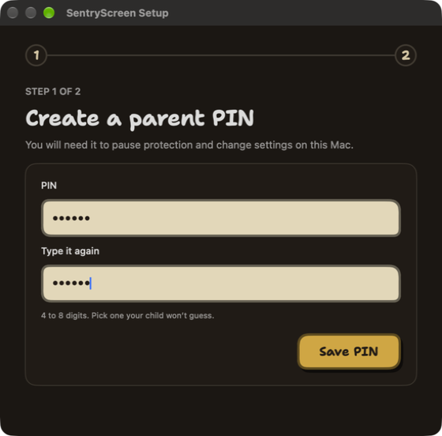<br><sub>Create a parent PIN</sub></td>
    <td align="center">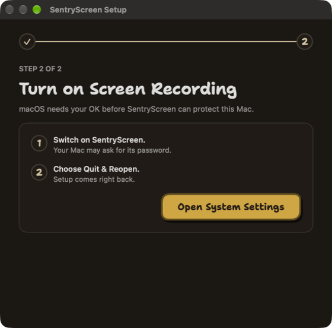<br><sub>Allow Screen Recording</sub></td>
  </tr>
  <tr>
    <td align="center">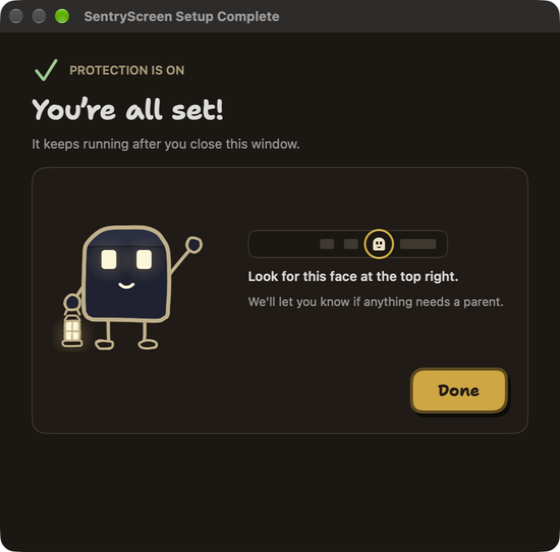<br><sub>Protection is on</sub></td>
    <td align="center">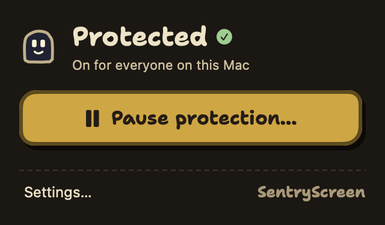<br><sub>Menu bar status</sub></td>
    <td align="center">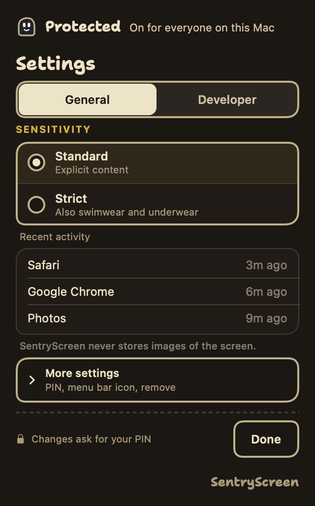<br><sub>Parent settings</sub></td>
  </tr>
</table>

<sub>Setup windows captured from the installed app; the menu bar panels are the app's own <code>--ui-demo</code> renders on fake state.</sub>

## Privacy

- Everything runs on the Mac. Screen frames go to a Core ML model in memory and
  are never sent. The installed app never stores them. The exception is a
  developer command-line option you run yourself: `--dev-crop-dir`, used to
  build training data, saves crops of what was detected to the folder you name.
  The installed app never uses it.
- SentryScreen makes **one** kind of network request: a diagnostic report that the
  Mac's owner reviews in full and chooses to send. It is never sent automatically,
  it carries no screen content, and it is a one-way send with no User-Agent header.
  Details: [docs/diagnostics.md](docs/diagnostics.md).
- No accounts, no telemetry, no analytics, no update checks. To update, download a
  newer release from GitHub Releases.

## Honest limits

It is a filter, not a guarantee. The model can miss content, content can show for
a fraction of a second before the cover appears, and a window entering or leaving
full screen shows its content for about half a second during the macOS animation.
It covers the display it captures; a second display is not covered.

## Requirements

- **Tested:** Apple silicon on macOS 27.
- **Builds, untested:** Intel Macs, and macOS 14, 15 and 26. The package is
  universal and should run there, but nobody has checked yet. Reports welcome.
- Apple silicon uses the Neural Engine at 30 frames per second. Macs without one
  run at 15 frames per second, which reacts more slowly to fast motion.
- To build: Xcode Command Line Tools (`xcode-select --install`). Full Xcode is
  not needed.

## Download

Get the newest installer package (`SentryScreen-<version>.pkg`) from
[GitHub Releases](https://github.com/SaintsGlobal/sentryscreen/releases) and open it
from an administrator account. Or build it yourself, below.

Release packages are signed with a Developer ID and notarized by Apple, so
they open with a normal double-click.

Updates from a release keep the **Screen Recording** permission. A package
you build yourself is ad-hoc signed by default, and macOS ties the permission to
that exact build. When the new or the replaced app is ad-hoc signed, the
installer clears the old entry (`tccutil reset ScreenCapture
com.sentryscreen.agent`) so the app asks again. If SentryScreen is switched on
but the app still says it is off, select it in System Settings › Privacy &
Security › Screen & System Audio Recording, remove it with the minus button,
then add it again or press **Open System Settings** in the app.

## Build from source

```bash
git clone https://github.com/SaintsGlobal/sentryscreen.git
cd sentryscreen
scripts/build.sh                            # universal arm64 + x86_64
SENTRY_BUILD_ARCHS=arm64 scripts/build.sh   # faster, this Mac only
```

`scripts/build.sh` compiles with `swiftc` directly; do not use `swift build` or
`xcodebuild`. If its SDK check stops, rerun with the `SDKROOT=...` it prints.

## Install

Build an installer package and install it:

```bash
bash packaging/build-pkg.sh
sudo installer -pkg packaging/out/SentryScreen-*.pkg -target /
```

Then sign in to each account that should be protected and allow **Screen
Recording** for SentryScreen in System Settings › Privacy & Security. The app
walks you through it. macOS asks the user to re-confirm screen capture from time
to time.

<details>
<summary>Signing, and installing without a package</summary>

A source-built app is signed ad-hoc, so macOS asks for Screen Recording again
after each rebuild. With an Apple Development certificate, build with
`SENTRY_SIGN_MODE=development` to keep the permission across rebuilds; set
`SENTRY_TEAM_ID` to your team. Developer ID signing and notarization are optional:
see the header of `packaging/build-pkg.sh` and `packaging/notarize-pkg.sh`.

Without a package, `packaging/bundle.sh` followed by
`sudo SENTRY_ALLOW_ADHOC_INSTALL=1 packaging/install.sh` installs the same layout
from the build directory. The variable allows an ad-hoc signed build, which the
install preflight refuses otherwise; leave it out for a Developer ID build.
</details>

## Uninstall

In an administrator account, open the menu bar item › **Uninstall
SentryScreen…** (the last line of the popover in every state, and at the bottom
of the Setup window), or Settings › **Remove SentryScreen…**. The parent PIN is
asked first when one is set; the Uninstaller then asks for an administrator
password. Or, in Terminal:

```bash
sudo "/Library/Application Support/SentryScreen/uninstall.sh"
```

A forgotten parent PIN is reset with
`sudo "/Library/Application Support/SentryScreen/reset-pin.sh"`.

## Panic hotkey

Hold **Control + Option + Command + X** for one second and authenticate as an
administrator. All covers are removed and detection pauses for five minutes.
Covers are click-through by construction, so the worst failure is "cannot see",
never "cannot click". If the small covers fill more than 90% of the screen for
over a minute, SentryScreen lifts them for 10 seconds on its own. Window covers
and detection stay on, and each lift is written to the parent alert log.

## Tuning tools

Every build includes the tuning tools:

- **Settings › Developer:** per-class thresholds, size floors (`thresholdSteps`),
  curtain hit counts and hold times, with a live "Last 60 s" readout of hits and
  of which rule removed a box. Changes are written to `parent/tuning.json` behind
  the parent PIN and apply within a second.
- **Detection view:** outlines of what the model sees, over or instead of the
  covers, for a few minutes at a time, including weak detections below the
  blocking threshold.
- The same policy can be set in `config.json` under `"tuning"`; an unknown key or
  out-of-range value is refused by name. `sentry-screen --print-tuning` prints the
  policy in force. The fields and their meaning are documented on
  `TuningPolicy` in `daemon/Sources/SentryScreen/TuningPolicy.swift`.

<details>
<summary>Running from Terminal (development)</summary>

```bash
daemon/.build/sentry-screen --cover curtain --ttl 300 --log run.jsonl
```

Grant Screen Recording to the terminal first. `--ttl` makes the process exit by
itself (always use it for development runs). `--model <path>.mlpackage` loads
another model. `--dev-inject` enables the fake-detection hotkey (Control + Option +
Command + I) for testing covers without real content. `--ui-selftest` runs the UI
self-checks. `scripts/health_report.py` summarizes an installed Mac's logs.
</details>

## Model

The detector is a YOLOX-S model trained for this app,
`model/weights/yolox_50ep_v8_ep50_fp16.mlpackage`, licensed under AGPL-3.0. It
was trained on screen-like composites with labels from NudeNet; the training
dataset is not published. The model card, its limits, and the code to retrain and
export it with your own data are in [model/README.md](model/README.md).

## Help make it better

SentryScreen gets better when people tell us where it slips. If it **missed**
something it should have covered, or **covered something harmless** (a false
positive), please [open a "Missed or false cover" issue](https://github.com/SaintsGlobal/sentryscreen/issues/new/choose)
with the app or site, what was on screen in words, your Mac and macOS version, and
the sensitivity setting. Please never attach explicit images; a description is
enough.

What is planned next is in [docs/roadmap.md](docs/roadmap.md); changes per
release are in [CHANGELOG.md](CHANGELOG.md).

Code is just as welcome: detector tuning, new cover behaviour, accessibility,
docs, tests. Read [CONTRIBUTING.md](.github/CONTRIBUTING.md) for the build, the house rules
(no telemetry, limits fail loudly) and the DCO sign-off, then send a pull request.

## Contributing and security

See [CONTRIBUTING.md](.github/CONTRIBUTING.md). Report vulnerabilities privately as
described in [SECURITY.md](.github/SECURITY.md), not in a public issue.

## License

SentryScreen, including the model weights, is licensed under the
[GNU Affero General Public License v3.0](LICENSE). See [NOTICE](NOTICE) for
attributions and [packaging/THIRD-PARTY.txt](packaging/THIRD-PARTY.txt) for
third-party notices.

---

<p align="center">
  <sub>SentryScreen is free and always will be. If it helps your family and you'd like to chip in,
  you can <a href="https://www.sentry-screen.com/#support">support the project</a>. Thank you.</sub>
</p>
